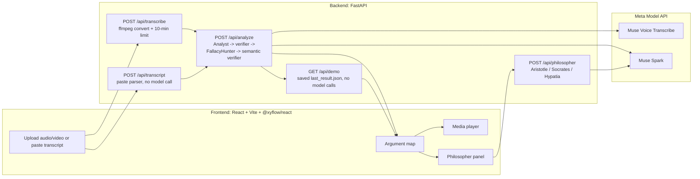

# Hypatia — Debate X-Ray with Philosopher Judges

Upload a debate or podcast. Hypatia transcrices it, maps every argument
(premises → conclusion, with clickable timestamps), flags logical fallacies,
verifies its own claims, and lets you ask a philosopher — Aristotle, Socrates,
or Hypatia — who is right, each judging with their *own* method.

Left panel: media player. Middle: argument map (React Flow). Right:
philosopher panel. Click a map node to seek the player to that second.
Fallacy badges (e.g. "Straw man", "Ad hominem") carry the exact quote and a
short explanation. Every item shows verifier status: verified or uncertain
(shown, greyed). Demo debates are non-political, and Hypatia never gives
medical or mental-health advice.

## Screenshots

Screenshots live in `docs/screenshots/` (placeholders until the demo video is
recorded):

- `docs/screenshots/argument-map.png` — argument map with fallacy badges.
- `docs/screenshots/philosopher-panel.png` — philosopher verdict with
  clickable node references.

## Architecture



Pipeline detail: the Analyst drafts nodes + edges, the deterministic verifier
checks every quote against the transcript and every timestamp against its
segment (failures become `verified=false`), the FallacyHunter drafts fallacy
flags (verified the same way), and the semantic verifier asks the model "does
this quote actually support this label?" and can only downgrade, never
upgrade. All network calls go through one module,
`backend/app/meta_client.py`, so tests can mock it.

## Which Meta model does what

Model IDs always come from env vars (`META_TEXT_MODEL`,
`META_TRANSCRIBE_MODEL`); defaults are in `backend/.env.example`.
Base URL: `https://api.meta.ai/v1`.

| Step | Agent | Model (env var) | How it is called |
|---|---|---|---|
| Speech → text with speakers + timestamps | Transcriber | `META_TRANSCRIBE_MODEL` (Muse Voice Transcribe) | `POST {BASE}/asr/transcribe` via httpx multipart (WAV only, up to 10 min; other formats converted with ffmpeg first) |
| Claims / premises / conclusions → JSON graph | Analyst | `META_TEXT_MODEL` (Muse Spark) | Chat Completions structured output (`json_schema`), validated with pydantic, retried once |
| Fallacy detection with quote + timestamp | FallacyHunter | `META_TEXT_MODEL` | Same structured-output chat call, then deterministic verifier |
| Check every quote and label against transcript | Verifier | Deterministic checks + `META_TEXT_MODEL` (semantic verifier, tool-style question) | Deterministic first, model only for semantic support checks |
| Verdict / questions / proof check | Philosopher (Aristotle, Socrates, Hypatia) | `META_TEXT_MODEL` | Structured output; every point must cite real node ids or the reply is rejected |

No other model calls exist. Demo mode (`GET /api/demo`) makes zero model
calls — it serves `backend/data/last_result.json`.

## Setup (Windows)

Prerequisites: Python 3.12 (`py -3.12`), Node.js + npm, and ffmpeg on `PATH`
(needed to convert mp3/m4a/mp4 uploads to WAV; WAV uploads work without it).

1. Backend config — copy the example and fill in your key:

   ```powershell
   Copy-Item backend\.env.example backend\.env
   # edit backend\.env: META_API_KEY=<your key>
   ```

   Secrets live only in `backend\.env` (gitignored). Never commit a key.

2. Backend — create the venv and install (or let `scripts/check.ps1` do it):

   ```powershell
   py -3.12 -m venv backend\.venv
   backend\.venv\Scripts\python.exe -m pip install -r backend\requirements.txt
   cd backend
   .\.venv\Scripts\python.exe -m uvicorn app.main:app --port 8000
   ```

3. Frontend — in a second terminal from the repo root:

   ```powershell
   cd frontend
   npm ci        # first run only: npm install
   npm run dev   # Vite dev server; /api is proxied to http://localhost:8000
   ```

4. Open the Vite URL in a browser. Upload audio (mp3, wav, m4a, mp4, up to
   10 minutes), paste a transcript (`[MM:SS] Speaker: words`, one turn per
   line), or click **Load demo instantly** (serves the saved
   `backend/data/last_result.json` with no model calls — for recording the
   demo video).

5. Quality gate (backend offline tests + frontend production build):

   ```powershell
   powershell -ExecutionPolicy Bypass -File scripts/check.ps1
   ```

Unit tests run offline with the model mocked; canned replies live in
`fixtures/`. The live smoke test in `backend/tests/live/` runs only with
`RUN_LIVE=1` and is not part of `check.ps1`. Never download media from
YouTube or other sites.

## Built during the hackathon

Everything in this repo was built during the Meta Global AI Developer
Hackathon (Indie track, theme **Build for Your World**) toward the Nov 4
submission deadline: FastAPI backend (transcribe / transcript / analyze /
philosopher / demo endpoints), the Analyst → verifier → FallacyHunter →
semantic-verifier pipeline with all calls through `meta_client.py`, the
React + Vite + React Flow UI (intake screen, clickable argument map, fallacy
side card, philosopher panel with node highlighting and one follow-up), the
three philosopher methods (Aristotle's syllogistic verdict, Socrates'
verdict-free probing questions, Hypatia's geometric proof check — with the
note that none of her writings survive, so the method is inspired by the
mathematical tradition she taught), demo mode with a seeded non-political
debate, offline tests for every module, and this README.
